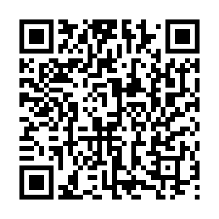

<!-- independent-distribution -->
# ShaderEditor for Android

GLSL editor and live previews. This independently signed edition builds the [original 2.36.3 release](https://github.com/markusfisch/ShaderEditor/tree/f534a689e20b958a9b88cf049d30b56670850505) from source. The upstream name, license and application features are preserved.

[Download APK and AAB](https://github.com/hamzabounibanedz/shader-editor-android/releases/latest) · [Cloud build and emulator results](https://github.com/hamzabounibanedz/shader-editor-android/actions/workflows/distribution.yml)

Download the APK on your phone and open it. Android may ask you to allow the download source to install apps. The package uses its original Android identifier and an independent signing certificate. An existing installation signed by another distributor cannot receive this APK as an in-place update.

Run **Actions → Build, test and release Android → Run workflow** to compile, sign, install and test on a hosted Android emulator, and publish a new release. The release includes the APK, AAB, SHA-256 checksums, installation QR and device evidence. Repository signing secrets are ANDROID_KEYSTORE and ANDROID_KEYPASS. No backend or login is required.

## Upstream documentation

# Shader Editor

Create and edit [GLSL](https://en.wikipedia.org/wiki/GLSL) shaders on
your Android phone or tablet and use them as live wallpaper.

If you find this app useful and wish to support its continued development,
you can [buy me a coffee](https://www.buymeacoffee.com/markusfisch) or
send some Bitcoin decimals to `bc1q2guk2rpll587aymrfadkdtpq32448x5khk5j8z`.

&nbsp;

## Screenshots

## Download

 

## Features

* Live preview in the background or on an extra screen
* Syntax highlighting
* Error highlighting
* Use any shader as live wallpaper
* Exposure of sensors (camera, accelerometer, gyroscope, magnetic field,
	light, pressure, proximity)
* Exposure of battery level
* Supports wallpaper offset
* Supports multiple touches
* Supports multiple render resolutions
* Previously rendered frame in backbuffer texture
* Import and use arbitrary textures
* Create and use cube maps
* Disables rendering when the battery is low

See [FAQ.md](FAQ.md) for frequently asked questions.
